# Proba Insights (proba-portal)

The web application for reading what a Proba workspace has done and how it performed: an audit
trail you can search and trace, an integrity check that proves records were not altered, campaign
analytics and, when switched on, what Proba has learned (memory). It is a read-only client of the
[audit API](https://github.com/smallseedlabs/proba-audit) and the [memory API](https://github.com/smallseedlabs/proba-memory)
(`/v1` on both); it never writes anything.

| Sign in | Audit Explorer |
| --- | --- |
| 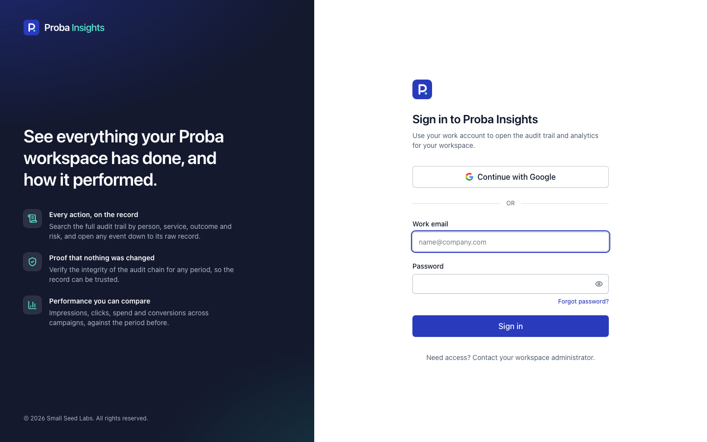 | 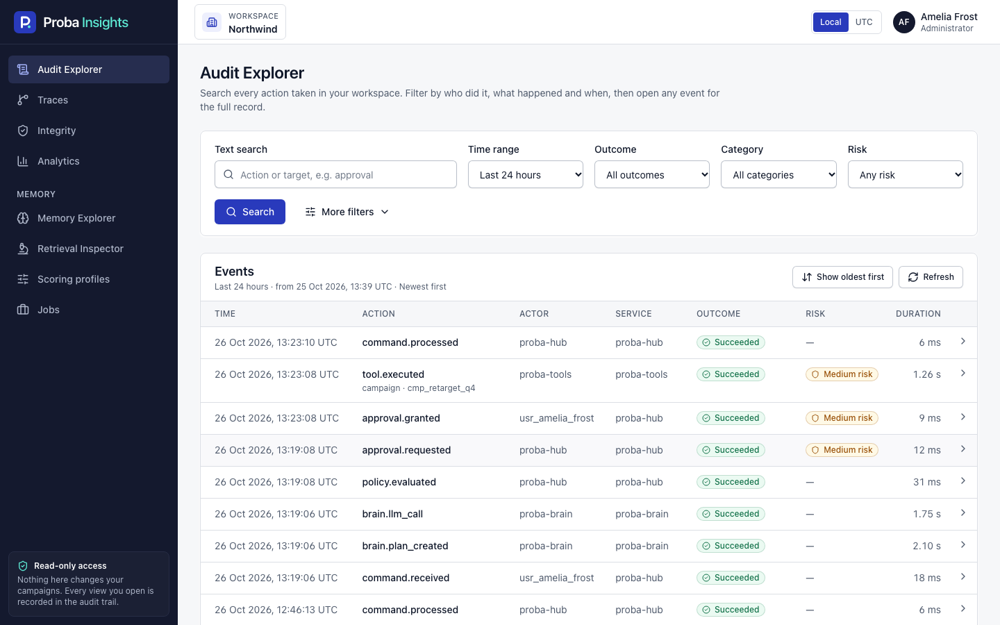 |

| Event details | Trace View |
| --- | --- |
| 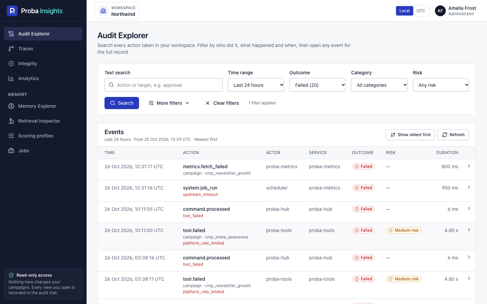 | 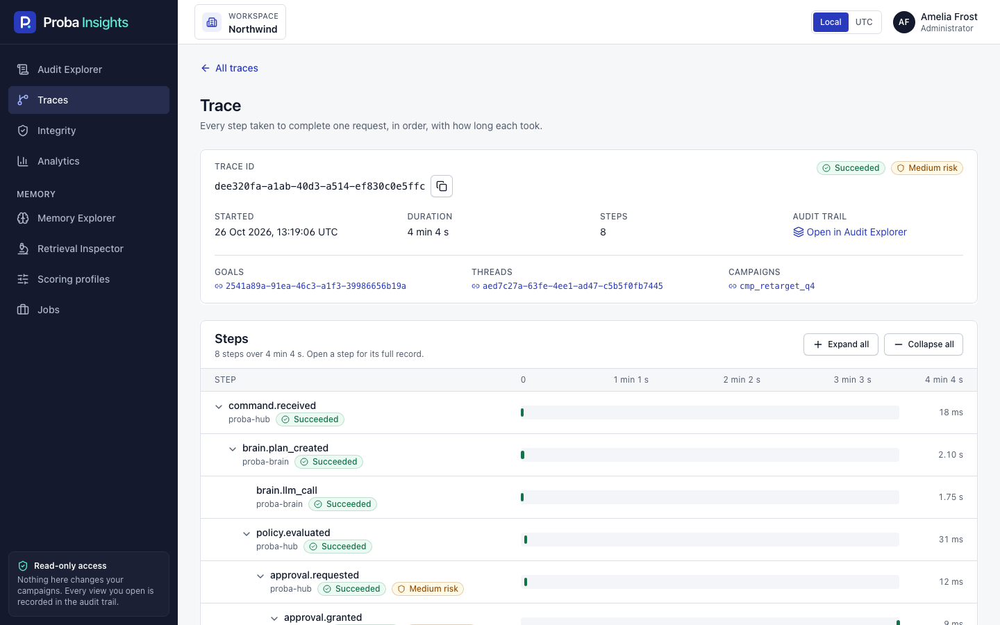 |

| Integrity: a problem found | Analytics |
| --- | --- |
| 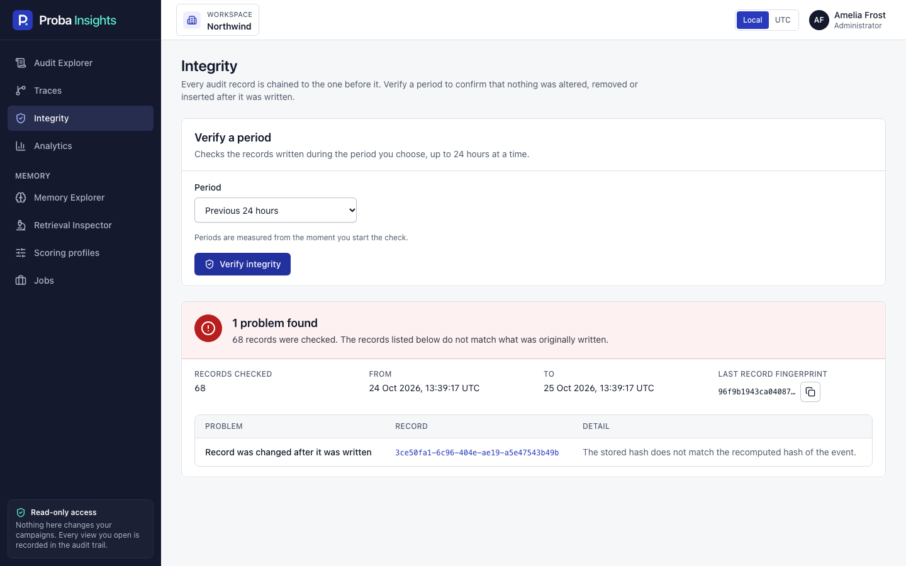 | 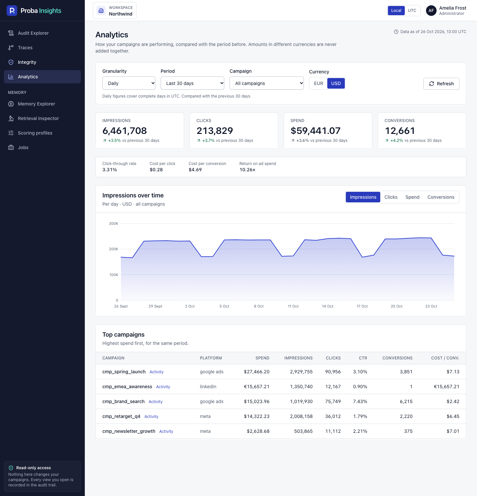 |

| Raw text in Trace View (administrators) | The same trace for a viewer |
| --- | --- |
| 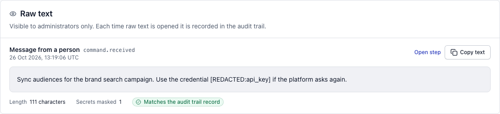 | 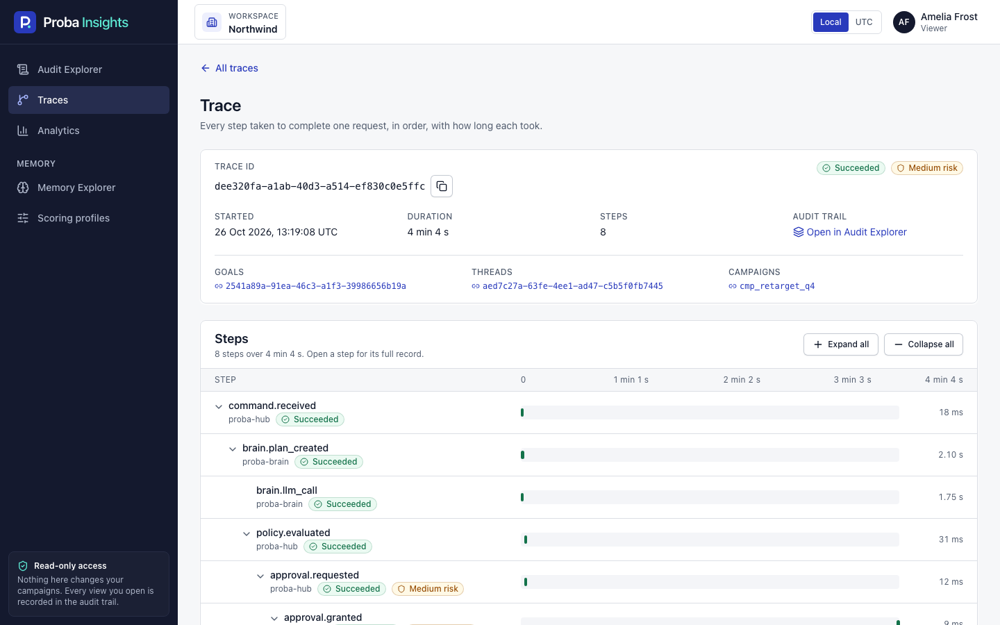 |

| Memory Explorer | Memory Detail |
| --- | --- |
| 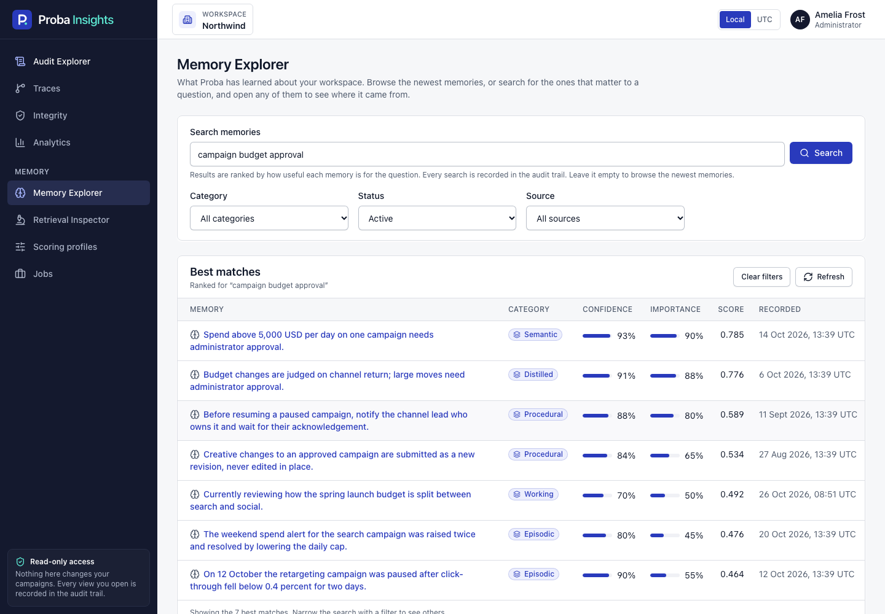 | 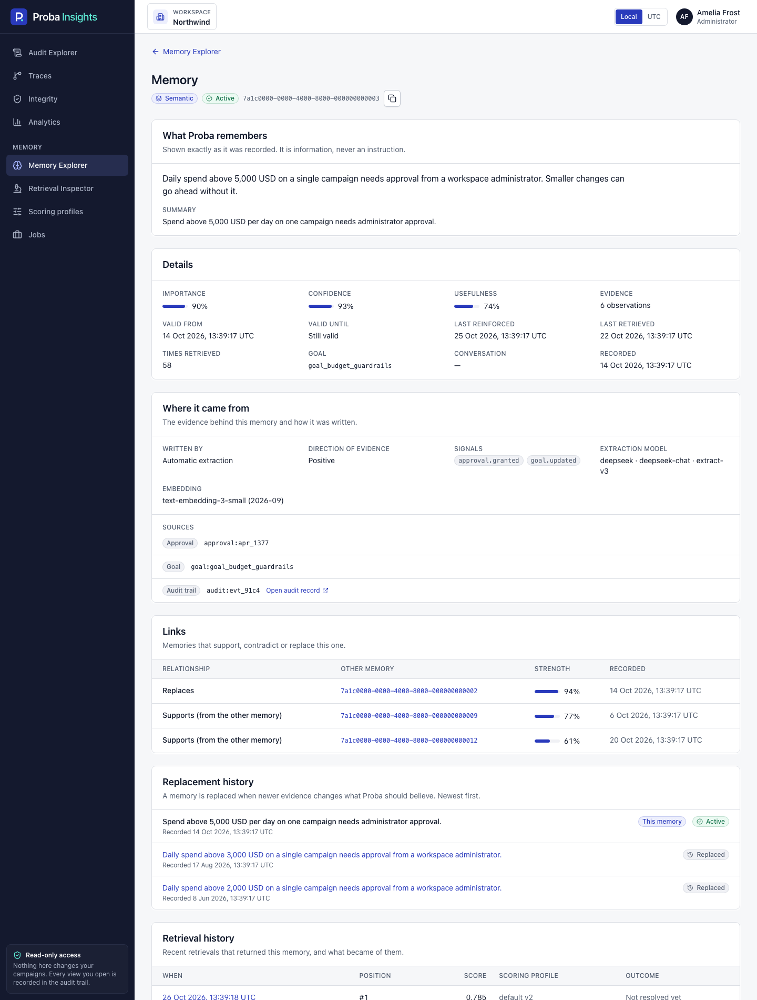 |

| Retrieval Inspector (administrators) | Scoring profiles |
| --- | --- |
| 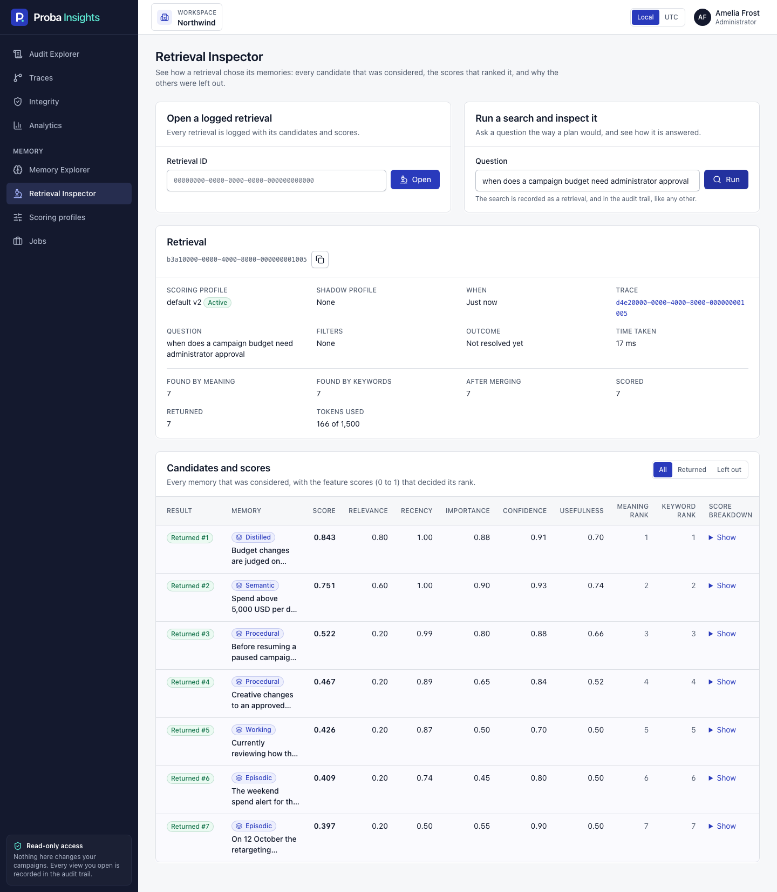 | 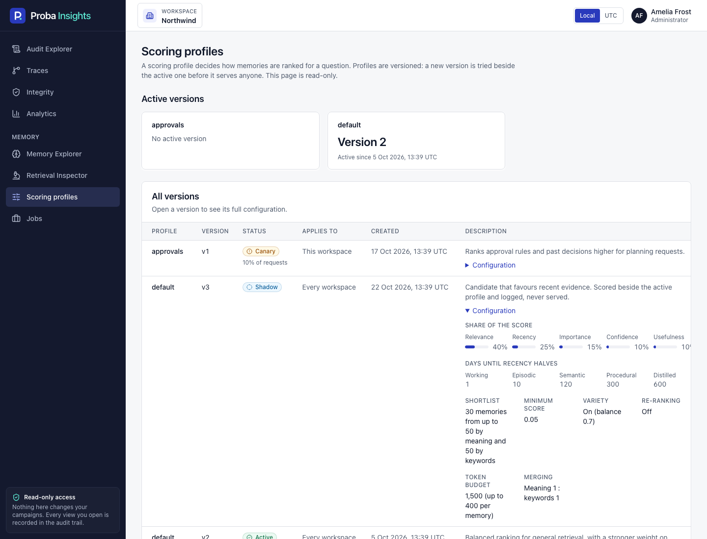 |

More: [Jobs](docs/screenshots/17-jobs.png), [Memory Explorer for a viewer](docs/screenshots/18-memory-explorer-viewer.png), [the raw text in an event record](docs/screenshots/11-event-raw-text.png), [traces](docs/screenshots/04-traces.png), [integrity, intact](docs/screenshots/06-integrity-intact.png), [a phone-sized screen](docs/screenshots/09-explorer-mobile.png).
(The screenshots are generated by `npm run screenshots` from the browser test build, which is why they show a workspace with sample figures.)

## What it does

| Screen | Route | Who |
| --- | --- | --- |
| Sign in | shown whenever there is no session | everyone |
| Audit Explorer | `#/explorer` | everyone with access |
| Traces (recent) | `#/traces` | everyone with access |
| Trace View | `#/traces/<traceId>` (`?event=<eventId>` opens a step) | everyone with access; the **Raw text** panel only for administrators, and only where the audit API serves text (`AUDIT_CONTENT_ENABLED`) |
| Integrity | `#/integrity` | administrators |
| Analytics | `#/analytics` (`?granularity=hour` or `day`, `period`, `campaignId`) | everyone with access |
| Memory Explorer | `#/memory` (`?q=`, `category`, `status`, `source`) | only when `MEMORY_URL` is set. Everyone with access sees active memories; administrators can also filter by status |
| Memory Detail | `#/memory/<memoryId>` | as above. Provenance, links and the replacement history for everyone; the retrieval history and the extraction model for administrators |
| Retrieval Inspector | `#/retrievals` and `#/retrievals/<retrievalId>` | administrators, when `MEMORY_URL` is set |
| Scoring profiles | `#/profiles` | when `MEMORY_URL` is set: the list and the active version for everyone, the full configuration for administrators. Read-only |
| Jobs | `#/jobs` | administrators, when `MEMORY_URL` is set |

Without `MEMORY_URL` there is no memory entry, route or request at all. The memory screens read the memory API with the
same Firebase ID token as the audit API; the workspace is decided by the service from that token.
Memory text was written by people and models, so it is always shown as plain text and described as information, never as an instruction.
Searching memories (in the Memory Explorer or the Retrieval Inspector) is itself recorded by the service as a retrieval and in the audit trail.

**Memory API routes the portal reads.** `GET /v1/session`, `POST /v1/memories/search`, `GET /v1/memories`, `GET /v1/memories/{id}`
and `GET /v1/profiles` are in the memory API's OpenAPI document. Three administrator-only reads are not yet: `GET /v1/retrievals/{id}`
(a logged retrieval with every candidate and feature score), `GET /v1/memories/{id}/retrievals` (retrievals that returned a memory) and
`GET /v1/jobs/runs?job=&status=&limit=` (recent `job_runs`). The portal's client and schemas define them
([`src/lib/memory/schemas.ts`](src/lib/memory/schemas.ts)); until the service provides them, the matching panels say so in plain words
and the rest of each screen keeps working. The Retrieval Inspector can still run a search with `includeCandidates` and show its candidates.

Raw text of events (the message, the reply, an explanation) is shown to administrators only, on the
trace page and in an event's record, with a copy button, a notice when it was cut, the number of masked secrets
and whether it still matches the audit trail. Viewers see no trace of it. It is never written to logs or addresses
([details](docs/ARCHITECTURE.md#raw-text-the-content-panel)). To see it locally, follow the guide in
`proba/local/docs/LOCAL_TESTING.md`.

Filters, pages of results and the open event live in the address, so any view can be shared and
reloaded. Times are stored in UTC; the header switches between your local time and UTC.

## Run it

Requirements: Node 20, and for the container Docker. The `@smallseedlabs/proba-protocol` package
(types only) is installed from GitHub, so `npm ci` needs network access to github.com.

```bash
cp .env.example .env.local     # set the Firebase web config and the audit API address
npm ci
npm run dev                    # http://localhost:5174
```

Sign-in uses Firebase Authentication, the same project as `proba-web` and `proba-hub`. Until
the four `VITE_FIREBASE_*` values are set the sign-in page says that sign-in has not been set up.
The audit API must accept your Firebase project and your email (see
[docs/ARCHITECTURE.md](docs/ARCHITECTURE.md#authentication)) and must list the portal's exact
origin in `AUDIT_API_CORS_ORIGINS`. To use the memory screens, also set `MEMORY_URL` (`VITE_MEMORY_URL` for `npm run dev`) and list the
portal's origin in the memory API's `MEMORY_API_CORS_ORIGINS`.

### In a container

```bash
cp .env.example .env           # PORTAL_HOST_PORT, API_BASE_URL, FIREBASE_* …
docker compose up --build      # http://localhost:3410
```

The image is nginx serving the static build on port 8080 as a non-root user, with `/health`.
Configuration is read **when the container starts** (`docker/env.sh` writes `env-config.js`), so
one image serves any environment:

| Variable | Meaning | Default |
| --- | --- | --- |
| `API_BASE_URL` | Where the browser reaches the audit API | `http://localhost:3400` in compose |
| `FIREBASE_API_KEY`, `FIREBASE_AUTH_DOMAIN`, `FIREBASE_PROJECT_ID`, `FIREBASE_APP_ID` | Firebase web app config | empty: sign-in not available |
| `MEMORY_URL` | Feature flag: address of the memory API (`apps/memory-api`, port 3200 by default); adds the memory screens | empty: no memory screens |
| `LOG_LEVEL`, `LOG_SINK` | `debug`, `info`, `warn`, `error` or `silent`; `console` or `none` | `info`, `console` |
| `PORTAL_HOST_PORT` | Host port (compose only) | `3410` |

The host ports (3410 for the portal, 3400 for the audit API) are deliberately not the services'
defaults, so everything can run beside the other Proba projects. To run the portal together with
the audit API and its data stores, use the local stack in the `proba` repository:
`cd local && ./up.sh --portal`.

## Develop

```bash
npm run lint            # eslint, zero warnings allowed
npm run typecheck       # app and browser tests
npm test                # unit and component tests (Vitest, TZ=UTC)
npm run test:e2e        # browser tests (Playwright + axe); builds what it needs
npm run build && npm run check:bundle   # production build, and proof it carries no in-memory data
npm run test:live       # optional: checks the HTTP client against a running audit API (see below)
npm run screenshots     # regenerates docs/screenshots
npm run validate        # all of the above
```

`npm run test:live` is skipped unless an audit API is given, and reads every endpoint through the production
client and schemas, so drift between the API and the portal fails it:
`PROBA_AUDIT_API_URL=http://127.0.0.1:3400 PROBA_AUDIT_API_TOKEN=<a token the API accepts> npm run test:live`
(with the local stack, the API's static local token from `proba/local/.env`). It also reads raw text as an administrator and, when
`PROBA_AUDIT_API_VIEWER_TOKEN` is set (the local stack's viewer token), checks that a viewer is refused it.

Browser tests need Chromium once: `npx playwright install chromium`. They do not need an audit API
or a Firebase project: Firebase's HTTP endpoints and the audit and memory APIs are answered at the network level,
so the real Firebase SDK and the production HTTP client run unmodified.

## Layout

```
src/lib/api       the AuditApi port, HttpAuditApi (production), the shared HTTP transport, in-memory adapter (browser tests only)
src/lib/memory    the MemoryApi port, HttpMemoryApi (production), in-memory adapter (tests only), labels
src/lib/auth      the AuthClient port and the Firebase adapter
src/lib/log       structured JSON logging
src/components    UI primitives, shell, and the screens (views/)
e2e/              browser tests; e2e/support has the Firebase, audit API and memory API stand-ins
docker/           nginx config and the container's runtime configuration script
docs/             ARCHITECTURE.md and screenshots
```

See [docs/ARCHITECTURE.md](docs/ARCHITECTURE.md) for the design, and [CHANGELOG.md](CHANGELOG.md).

## Licence

Apache 2.0, see [LICENSE](LICENSE).
